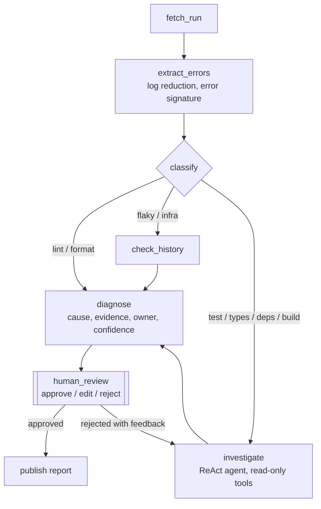

# ci-triage-agent

[](https://github.com/NK8007/ci-triage-agent/actions/workflows/ci.yml)
[](https://github.com/NK8007/ci-triage-agent/actions/workflows/codeql.yml)
[](LICENSE.md)

An AI agent that triages failed GitHub Actions runs. It reads the logs, finds similar past failures,
proposes a root cause and an owner, and waits for a human to approve the diagnosis before anything
is published.

> **Status:** early development. The repository currently contains the engineering foundation
> (tooling, CI, security checks). The agent itself is being built in small pull requests.

## Why

In large CI environments, many pipelines fail every day and someone has to read each log, find the
cause and hand it to the right person. This project is a public, from-scratch take on an approach I
used in production to triage hundreds of failing pipelines a day. It runs on open data from public
repositories.

## How it will work



- **Graph:** LangGraph with a human-in-the-loop interrupt before publishing.
- **Retrieval:** hybrid search (BM25 and embeddings) over past issues and developer docs.
- **Ownership:** owners resolved from `CODEOWNERS`.
- **Safety:** the agent has read-only tools. Logs and issues are treated as untrusted input.

## Roadmap

| Version | Scope |
|---|---|
| v0.1 | Log reduction, error signatures, `CODEOWNERS` parser, triage graph with human review in a CLI |
| v0.2 | RAG index, golden dataset and evaluation in CI |
| v0.3 | Async FastAPI service, Docker Compose, tracing and cost tracking |
| v0.4 | MCP server |
| v0.5 | A2A and a multi-agent supervisor |

## Development

Requires [uv](https://docs.astral.sh/uv/).

```sh
uv sync                       # create .venv from uv.lock
uv run pre-commit install     # run checks on every commit
uv run pytest                 # tests with coverage
uv run ruff check             # lint
uv run ruff format --check    # formatting
uv run mypy                   # type checking (strict)
```

## Quality gates

Every change goes through a pull request. A ruleset on `main` requires all checks below to pass and
allows only squash merges, so each PR title becomes one Conventional Commit on `main`.

| Check | Tool | What it enforces |
|---|---|---|
| `lint` | Ruff | lint rules and formatting |
| `typecheck` | mypy | strict typing |
| `test (3.12)`, `test (3.13)` | pytest, pytest-cov | tests on all supported Python versions, branch coverage of at least 80% |
| `pr-title` | action-semantic-pull-request | Conventional Commits format of the PR title |
| `dependency-review` | dependency-review-action | no known vulnerabilities and only allowed licenses in new dependencies |
| `CodeQL` | CodeQL | static security analysis of the Python code and the workflows |

Supply chain:

- GitHub Actions are pinned to full commit SHAs.
- Dependabot updates dependencies and actions weekly, with a 7-day cooldown for new releases.
- Secret scanning with push protection on GitHub and gitleaks in the pre-commit hooks.

## License

[MIT](LICENSE.md)
